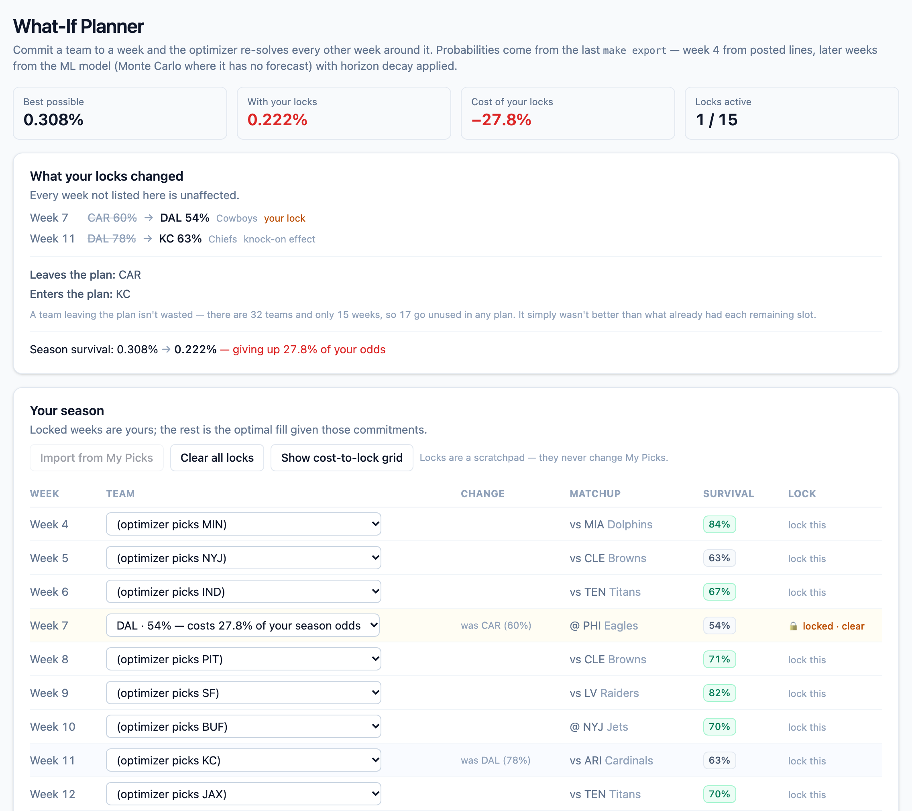
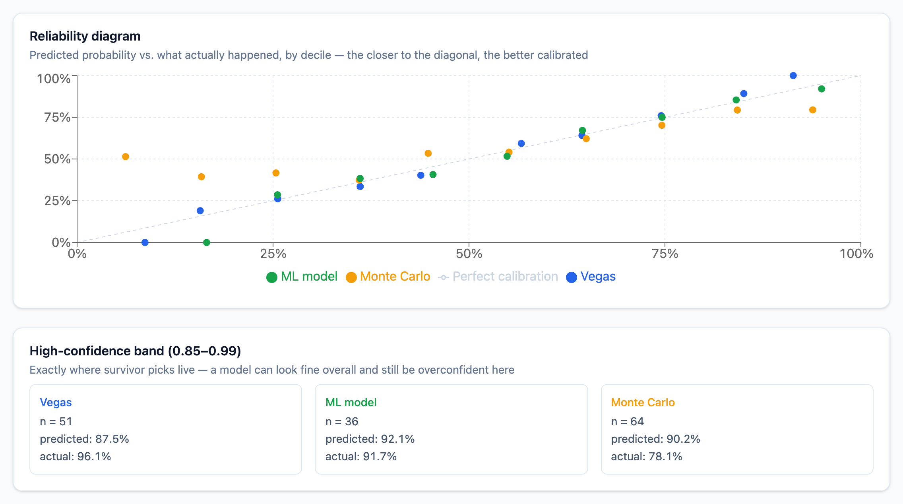
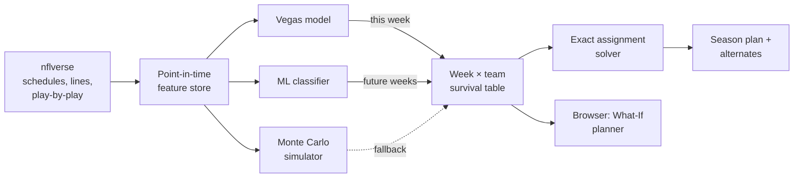
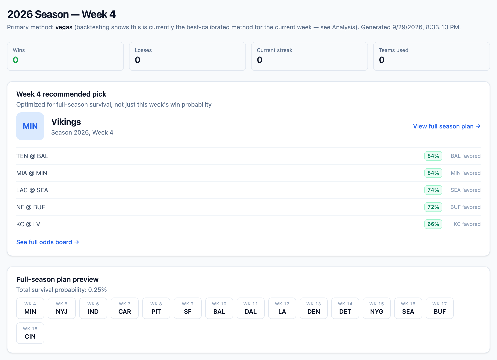
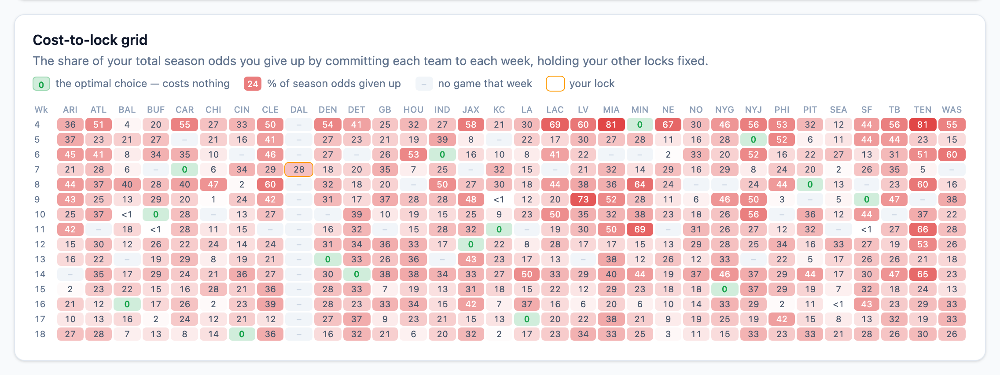

# NFL Survivor Pool Optimizer

**Plans an entire season of survivor-pool picks at once, using calibrated win probabilities and an exact optimizer.**

In a survivor pool you pick one NFL team to win each week, you can never use the same team twice, and one loss knocks you out. The usual approach, taking the safest team every week, burns your best teams early and leaves you picking coin flips in December. This project treats the whole season as one decision: it forecasts every remaining game, then finds the sequence of picks with the highest chance of surviving to the end.



<sub>The What-If Planner. Lock Dallas into week 7 when the plan was saving them for week 11, and the tool shows the knock-on (Kansas City takes over week 11) and what the change costs: 27.8% of the season's survival odds.</sub>

---

## Highlights

- **Three competing win-probability models**, compared on the same held-out games: a Vegas-line baseline, a drive-level Monte Carlo simulator, and a gradient-boosted classifier trained on 107 features.
- **Selected on calibration, not accuracy.** Models are judged by Brier score, log loss, and reliability in the 85–99% band where survivor picks actually live, with bootstrap confidence intervals to separate real differences from noise.
- **Walk-forward evaluation with no lookahead.** Every feature and every model is built only from data that existed before the game it predicts, enforced through a single point-in-time gate and verified by a test that fails when leakage is injected on purpose.
- **An exact season optimizer.** Maximizing the product of weekly survival probabilities is a bipartite assignment problem, solved exactly with the Hungarian algorithm rather than approximated with a greedy or search heuristic.
- **An interactive planner that re-solves instantly.** Lock any team into any week and the rest of the season re-optimizes in the browser in milliseconds, including a live grid pricing every possible team-and-week commitment.
- **Honest about what didn't win.** The trained model loses to the betting market for the current week, so the market stays the default there. The model is used only where it measurably helps.

## Results

Walk-forward on **1,084 decisive games from the 2022–2025 seasons**, every model scored on the same games without seeing their outcomes:

| Model | Brier score ↓ | Log loss ↓ | 85–99% band: predicted → actual |
|---|---|---|---|
| **Vegas line** (logistic on the spread) | **0.2101** | **0.607** | 87.5% → 96.1% (n=51) |
| **ML classifier** (gradient boosting, isotonic calibration) | 0.2236 | 0.636 | 92.1% → 91.7% (n=36) |
| **Monte Carlo** (drive-level simulation) | 0.2466 | 0.711 | 90.2% → 78.1% (n=64) |

What the evidence says, and what the system does about it:

1. **The betting market is the best forecaster available.** Vegas beats the ML model by 0.0135 Brier (95% CI 0.007–0.020) and the simulator by 0.0365. So when a line is posted, the optimizer uses it.
2. **The ML model clearly beats the simulator** (by 0.023 Brier, CI 0.013–0.033) and is far better calibrated at high confidence, the zone that matters. The simulator says 90% there and delivers 78%.
3. **That matters because future weeks have no betting line yet.** Before the ML model existed, the simulator was the only forecast for every week after the current one, and those weeks are most of what the season plan optimizes. They now use the ML model, with the simulator as a fallback only where ML has no forecast. Blends of the two were tested too: a fixed 50/50 average scored significantly *worse* than ML alone, and a blend with fitted weights tied it, so the simpler option won.



A backtest replaying the 2010–2025 seasons week by week reproduces the same ordering: plans built on Vegas lines survived 5.1 weeks on average, the ML model 3.7, and the simulator 2.9.

## How it works



1. **Data.** Schedules, betting lines, and play-by-play come from [nflverse](https://github.com/nflverse) through `nflreadpy`. No paid APIs or keys.
2. **Features.** Every feature is computed as of the moment before each game: opponent-adjusted efficiency ratings from a ridge regression over expected points added (EPA), drive-outcome distributions, recent form and trajectory, rest and travel, weather, and starting-quarterback continuity.
3. **Forecasts.** The current week uses the market line wherever one is posted. Later weeks use the ML model (the simulator fills in where it has no forecast), pulled toward 50% as the horizon grows, since a game ten weeks out is genuinely less predictable.
4. **Optimization.** Surviving every week means multiplying the weekly probabilities, which is the same as adding their logarithms. That makes the season a weeks × teams assignment problem with an exact solution. Murty's algorithm supplies the next-best alternative plans.
5. **Interface.** A React dashboard shows the week's recommended pick, the odds board, the full plan, model diagnostics, and the What-If planner.

## Screenshots

**Dashboard.** The pick for the current week comes straight from the full-season plan, so it accounts for every week after it.



**Cost-to-lock grid.** Every week against every team: the share of your season survival odds you give up by committing that team to that week. Green cells trace the optimal plan. A team's cost depends on what it would otherwise be saved for, not just its odds that week: a 76% favorite can cost more to use now than a 74% one.



## Engineering notes

**Preventing lookahead.** A model that sees the future looks brilliant in testing and is useless live, so leakage is handled structurally rather than by care:
- One gate, `AsOf.visible()` in [`clock.py`](backend/survivor/clock.py), is the only way any code reads historical data.
- Training is season by season on an expanding window: the model scoring 2024 was fit only on 2011–2023.
- Calibration is cross-validated inside the training seasons, so it never sees the season it scores.
- [`test_no_leakage_from_future_results`](tests/test_ml_features.py) erases every future result and asserts the features don't change. It was checked by injecting leakage deliberately and confirming the test fails.

**One optimizer, two languages, verified against each other.** The What-If planner re-solves in the browser because locks never change a win probability, only which cells the optimizer may use. The expensive forecasting runs once at export, and each re-solve after that is arithmetic on a table of a few hundred numbers. The TypeScript solver is tested against fixtures generated from SciPy's answers, and against the real exported plan, which it must reproduce exactly. Both suites were confirmed to fail when the solver was deliberately broken.

**A silent data bug, found and fixed.** Play-by-play data uses each franchise's current abbreviation for its whole history, while the schedule uses the one from that year, so `STL`, `SD` and `OAK` never matched `LA`, `LAC` and `LV`. Every Rams, Chargers and Raiders game before each relocation quietly disappeared from the backtest: 48 of 256 games in 2011 alone. Names are now normalized when the schedule loads.

**No invented numbers.** When a week has no posted lines yet, the system falls back to the models instead of treating a missing line as a 50/50 game, and the interface shows a dash rather than a fake percentage.

## Quickstart

Requires Python 3.12+ and Node 20+.

```bash
git clone https://github.com/zachwelch98/nfl-survivor.git
cd nfl-survivor

python3 -m venv .venv && source .venv/bin/activate
pip install -e ".[dev]"
cd frontend && npm install && cd ..

make web        # open http://localhost:5173
```

The repo ships with a data snapshot, so the app works on first launch. To pull fresh data and rebuild the forecasts:

```bash
make refresh                                   # download latest nflverse data
make export SEASON=2026 WEEK=4 USED="JAX,TB"   # rebuild for a week, excluding teams you've used
```

The dashboard also has buttons for these commands when running locally.

| Command | What it does |
|---|---|
| `make refresh` | Re-download schedules, lines and play-by-play (seasons picked automatically) |
| `make export` | Rebuild forecasts, season plan and dashboard data |
| `make export-full` | Also rebuild model comparison, backtest and simulation (slow) |
| `make backtest` | Replay the 2010–2025 seasons for every model |
| `make test` / `make test-web` | Python (217) and TypeScript (62) test suites |

## Project structure

```
backend/survivor/
  clock.py        point-in-time gate: the only way to read historical data
  data/           nflverse loaders, stadium locations
  features/       ratings, drive rates, situational and QB features
  models/         Vegas, Monte Carlo, ML classifier, blend (evaluated)
  evaluate/       Brier, log loss, calibration, bootstrap tests, model selection
  optimize/       exact assignment solver, k-best plans, forecast projection
  backtest/       week-by-week replay of real seasons
  export/         JSON data for the frontend
frontend/src/
  views/          Dashboard, Odds Board, Season Plan, What-If, Analysis
  lib/            browser assignment solver and What-If planner logic
tests/            217 Python tests (plus 62 in frontend/)
```

## Built with

**Python:** scikit-learn, SciPy, NumPy, polars, pydantic, click, pytest
**Frontend:** React, TypeScript, Vite, Tailwind CSS, Recharts, Zod, Vitest
**Data:** [nflverse](https://github.com/nflverse) via `nflreadpy`

---

<sub>For analysis and entertainment. Not betting advice.</sub>
